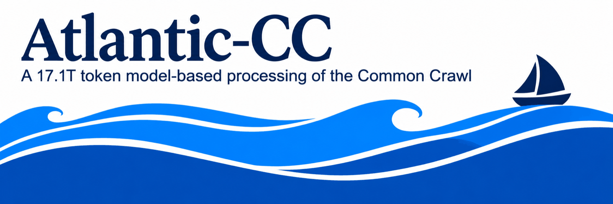

The code that built Atlantic-CC: 9.95B documents (17.1T tokens) from 8.58M Common Crawl WARCs, filtered by a
cascade of three classifiers, then globally deduplicated and decontaminated.

**Data:** [hosted by Common Crawl](https://data.commoncrawl.org/projects/atlantic-cc/v1.0/) ·
**Classifiers:** [fastText](https://huggingface.co/marin-community/atlantic-cc-fasttext) →
[pooled transformer](https://huggingface.co/marin-community/atlantic-cc-pooled-transformer) →
[ModernBERT](https://huggingface.co/marin-community/atlantic-cc-modernbert) ·
**Docs:** [docs/](docs/)

## Install

```bash
git clone https://github.com/marin-community/atlantic-cc && cd atlantic-cc
uv sync --extra torch        # GPUs or CPU; use --extra tpu on TPUs
```

Python 3.12. Extraction needs Linux x86_64 and the resiliparse-rs extension ([docs/extractor.md](docs/extractor.md)).

## Quickstart: one WARC

```bash
echo crawl-data/CC-MAIN-2026-12/segments/1772687277590.81/warc/CC-MAIN-20260308022436-20260308052436-00349.warc.gz > one.paths
uv run atlantic-cc extract-classify --warc-list one.paths --output out/ --backend torch --phase-a-procs 1
```

Writes `out/kept/data-4ff1f9108b5a.parquet`; the release kept 2,830 of this WARC's 19,112 pages.

## Reproducing the corpus

| Step | Command | Docs |
|---|---|---|
| Input list (8,582,115 WARCs) | `atlantic-cc worklist` | [worklist.md](docs/worklist.md) |
| Extract and classify | `atlantic-cc extract-classify` | [running.md](docs/running.md), [classifiers.md](docs/classifiers.md) |
| Deduplicate | `atlantic-cc dedup` | [dedup.md](docs/dedup.md) |
| Decontaminate | `atlantic-cc decon` | [decon.md](docs/decon.md) |
| Package the release | `atlantic-cc release` | [release_format.md](docs/release_format.md) |

CPU stages reproduce the release exactly; the neural classifiers match it bit for bit on production's
accelerator type and up to a few near-threshold decisions elsewhere ([reproducibility.md](docs/reproducibility.md),
[provenance.md](docs/provenance.md)).

## License

Code: Apache 2.0. Classifier weights: OpenMDW 1.1. The data is distributed by Common Crawl under its
[terms of use](https://commoncrawl.org/terms-of-use).
