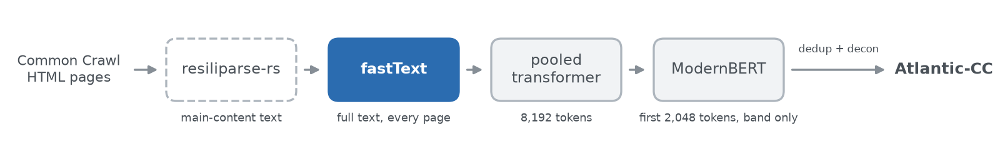

# Atlantic-CC fastText classifier

A [fastText](https://fasttext.cc) classifier that scores **P(useful)**, the probability that a web page has content worth keeping. It is the first, high-recall stage of the classifier cascade that built Atlantic-CC (hosted by Common Crawl; see <{{github_repo}}>).



**Operating point:** pages with P(useful) ≥ 0.0048 (compared in float32) go on to the [pooled transformer](https://huggingface.co/{{pooled_repo}}); the rest are dropped. Over the full v1.0 run, 56.5% of HTML pages passed.

## Usage

```python
import re

import fasttext
from huggingface_hub import hf_hub_download

model = fasttext.load_model(hf_hub_download("{{fasttext_repo}}", "model.bin"))


def p_useful(page_text: str) -> float:
    """P(useful) as the cascade computed it: normalized text, low-level predict, no trailing newline."""
    text = re.sub(r"\s+", " ", page_text).strip().lower()
    probs = {label: prob for prob, label in model.f.predict(text, 2, 0.0, "strict")} if text else {}
    return probs.get("__label__useful", 0.0)


pages = ["How to repot a fiddle-leaf fig\n\nChoose a pot 5 cm wider than the root ball.", "Home | About | Log in"]
print([p_useful(page) for page in pages])
```

`page_text` is resiliparse-rs main-content text, like the `text` column of Atlantic-CC. Avoid `model.predict()`: it appends a newline (an end-of-sentence token) and shifts the scores.

## Details

- **Training:** 5.6M pages from 640 Common Crawl WARCs, labeled by whether an LLM extraction pipeline kept the page.
- **Evaluation:** best F1 0.8196 on 6,477 pages from 89 held-out WARCs. The cascade uses a far lower threshold to keep nearly every useful page for the neural stages.
- **Reproducibility:** the code above reproduces the stored `fasttext_score` of 83,262 released documents bit for bit (`fasttext-wheel` 0.9.2 on Linux x86_64).
- **More:** input contract, numerics and training details in [docs/classifiers.md]({{docs_url}}); code at <{{github_repo}}>.

## Limitations

- It inherits one LLM pipeline's notion of useful content and was not evaluated per language or domain.
- It is not a toxicity, safety, personal-information, educational-value or licensing filter.
- The vocabulary in `model.bin` holds the words seen at least 500 times in the Common Crawl training text.

## License

[OpenMDW-1.1](LICENSE); see [THIRD_PARTY_NOTICES.md](THIRD_PARTY_NOTICES.md).

Research artifact. This model has not been properly tested or evaluated and is not necessarily secure. Use at your own risk in production settings.

We release our tools to the public with the intent that they are used safely, ethically, and responsibly. They are meant to contribute to the public's understanding of science, and aid in its advancement. By using this Marin model, you agree to comply with all applicable law.
