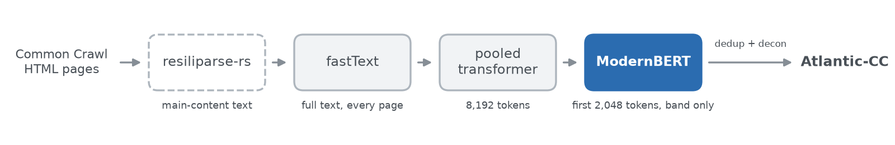

# Atlantic-CC ModernBERT classifier

A fine-tuned [Ettin-68M encoder](https://huggingface.co/jhu-clsp/ettin-encoder-68m), which has the ModernBERT architecture, that scores **P(useful)**, the probability that a web page has content worth keeping. It is the last stage of the classifier cascade that built Atlantic-CC (hosted by Common Crawl; see <{{github_repo}}>) and decides the pages the pooled transformer could not.



**Operating point:** for pages the [pooled transformer](https://huggingface.co/{{pooled_repo}}) scored in [0.079, 0.8883), keep if P(useful) ≥ 0.4378 on the first 2,048 tokens (compared in float32), else drop. Over the full v1.0 run this model saw 34.5% of the pages that passed fastText and kept 43.0% of them.

## Usage

```python
import re

import torch
from transformers import AutoModelForSequenceClassification, AutoTokenizer

repo = "{{terminal_repo}}"
tokenizer = AutoTokenizer.from_pretrained(repo)
model = AutoModelForSequenceClassification.from_pretrained(repo).to(torch.bfloat16).eval()  # production: bf16

pages = ["How to repot a fiddle-leaf fig\n\nChoose a pot 5 cm wider than the root ball.", "Home | About | Log in"]
texts = [re.sub(r"\s+", " ", page).strip().lower()[:65536] for page in pages]  # the cascade's normalization
batch = tokenizer(texts, truncation=True, max_length=2048, padding=True, return_tensors="pt")
with torch.no_grad():
    print(torch.softmax(model(**batch).logits.float(), dim=-1)[:, 1].tolist())
```

The pages are resiliparse-rs main-content text, like the `text` column of Atlantic-CC.

## Details

- **Training:** fine-tuned for one epoch on 10M pages from 345 Common Crawl WARCs, labeled by whether an LLM extraction pipeline kept the page ("ettin68-10M" internally, after the data size).
- **Evaluation:** best F1 0.8805 on 6,477 pages from 89 held-out WARCs (fastText 0.8196, pooled 0.8483).
- **Numerics:** production ran this model in bfloat16 on TPUs. On 1,629 released documents that production scored with it, bfloat16 runs elsewhere make the same keep decision for 99% or more, and every difference lies within 0.0055 of the threshold.
- **More:** input contract, numerics, architecture and training details in [docs/classifiers.md]({{docs_url}}); code, including a JAX implementation that reproduces production on TPUs, at <{{github_repo}}>.

## Limitations

- It inherits one LLM pipeline's notion of useful content and was not evaluated per language or domain, or on text from other extractors.
- It is not a toxicity, safety, personal-information, educational-value or licensing filter.
- Scores near 0.4378 depend on floating-point details; other hardware decides a small fraction of such pages differently.

## License

[OpenMDW-1.1](LICENSE). Fine-tuned from `jhu-clsp/ettin-encoder-68m` (MIT License) with the ModernBERT-base tokenizer (Apache-2.0); see [THIRD_PARTY_NOTICES.md](THIRD_PARTY_NOTICES.md).

Research artifact. This model has not been properly tested or evaluated and is not necessarily secure. Use at your own risk in production settings.

We release our tools to the public with the intent that they are used safely, ethically, and responsibly. They are meant to contribute to the public's understanding of science, and aid in its advancement. By using this Marin model, you agree to comply with all applicable law.
