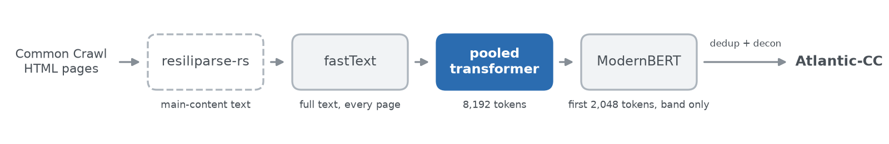

# Atlantic-CC pooled transformer

A small transformer (25.9M parameters) that scores **P(useful)** for a whole web page: it reads up to 8,192 ModernBERT tokens and pools them in windows of 64. It is the middle stage of the classifier cascade that built Atlantic-CC (hosted by Common Crawl; see <{{github_repo}}>).



**Operating point** (float32 comparisons): P(useful) ≥ 0.8883 keeps the page; P(useful) < 0.079 drops it; anything in between goes to the [ModernBERT classifier](https://huggingface.co/{{terminal_repo}}). Over the full v1.0 run this model accepted 18.3% of the pages that passed fastText, deferred 34.5% and dropped 47.1%.

## Usage

```python
import re

import torch
from transformers import AutoModelForSequenceClassification, AutoTokenizer

repo = "{{pooled_repo}}"
tokenizer = AutoTokenizer.from_pretrained(repo, trust_remote_code=True)  # ModernBERT-base's tokenizer
model = AutoModelForSequenceClassification.from_pretrained(repo, trust_remote_code=True).eval()

pages = ["How to repot a fiddle-leaf fig\n\nChoose a pot 5 cm wider than the root ball.", "Home | About | Log in"]
texts = [re.sub(r"\s+", " ", page).strip().lower()[:65536] for page in pages]  # the cascade's normalization
batch = tokenizer(texts, truncation=True, max_length=8192, padding=True, return_tensors="pt")
with torch.no_grad():
    print(torch.softmax(model(**batch).logits.float(), dim=-1)[:, 1].tolist())
```

The pages are resiliparse-rs main-content text. Load the weights in float32 (the default): like the TPUs that scored Atlantic-CC, the model rounds the inputs of its matrix products to bfloat16 internally.

## Details

- **Training:** 88.8M pages from 3,117 Common Crawl WARCs, labeled by whether an LLM extraction pipeline kept the page; trained from scratch for one epoch ("pooled-90M" internally, after the data size).
- **Evaluation:** best F1 0.8483 on 6,477 pages from 89 held-out WARCs.
- **Reproducibility:** on 2,000 released documents this code matches the stored scores to a median |ΔP| of 2.4e-7 (max 6.0e-4) and routes every one of them as production did.
- **More:** architecture, numerics, the original Levanter checkpoint (`levanter/`) and training details in [docs/classifiers.md]({{docs_url}}); code, including a JAX implementation, at <{{github_repo}}>.

## Limitations

- It inherits one LLM pipeline's notion of useful content and was not evaluated per language or domain, or on text from other extractors.
- It is not a toxicity, safety, personal-information, educational-value or licensing filter.
- Scores near 0.079 and 0.8883 depend on floating-point details; other hardware can route a few such pages differently.

## License

[OpenMDW-1.1](LICENSE). The tokenizer files are ModernBERT-base's (Apache-2.0); see [THIRD_PARTY_NOTICES.md](THIRD_PARTY_NOTICES.md).

Research artifact. This model has not been properly tested or evaluated and is not necessarily secure. Use at your own risk in production settings.

We release our tools to the public with the intent that they are used safely, ethically, and responsibly. They are meant to contribute to the public's understanding of science, and aid in its advancement. By using this Marin model, you agree to comply with all applicable law.
